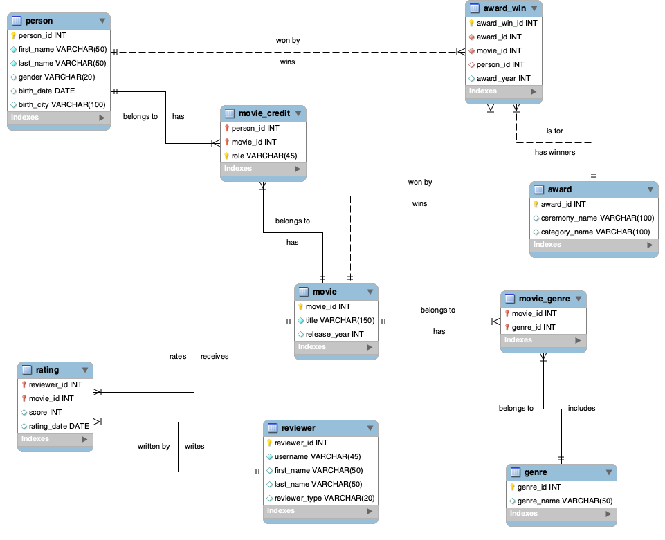

# NSC Individual Practice Movie Database – EER Diagram

## Project Overview
This project designs a movie database with about 40 sample records per table.

## Project Purpose
This database helps people who work in the movie industry and anyone
interested in movies, look up related information.

## Technologies Used
- MySQL
- MySQL Workbench
- Microsoft Excel
- GitHub

## Database Features
- View movie ratings
- Look up personal information about favorite actors and directors
- Find the movies they appeared in and the awards they won
- Find highly rated movies in the same genre
- See which awards a movie has won

## Database Design

One key design decision was the movie_credit table. One person can join a movie in more than one role. For example, Ben Affleck was the director, an actor, and a producer in Argo. If the primary key were only person_id and movie_id, his second and third roles would be duplicates and could not be saved. So the primary key includes person_id, movie_id, and role.

My biggest challenge was deciding how tables should relate to each other, how many tables I needed, and how deep to go. While checking data, I also found two famous people named Steve McQueen, so I had to confirm which one was the director.

To solve these problems, I followed the project handout, kept the design simple, and tested my tables by thinking through 1NF, 2NF, and 3NF.

Sample data was organized with AI help and checked on Wikipedia; reviewers and ratings are fictional.

## Project Structure
- EER_Diagram_Peng_Ning.png – EER diagram image
- EER_Diagram_Peng_Ning.png.mwb – MySQL Workbench model file
- NSC_Movie_Sample_Data_Peng_Ning.xlsx – sample data, one sheet per table
- README.md – project description

## How to Run the SQL Scripts
This project does not include SQL scripts yet; it focuses on the database
design. To view the model, download MySQL Workbench and open the .mwb file
(File → Open Model).

## Team Contributions
This is an individual assignment by Ning Peng.
